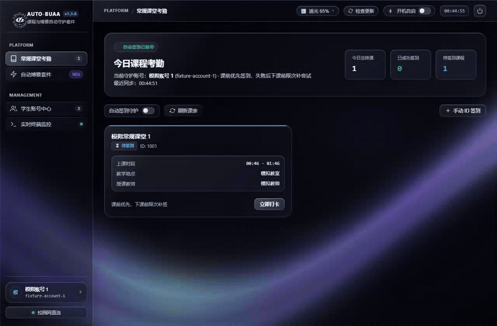
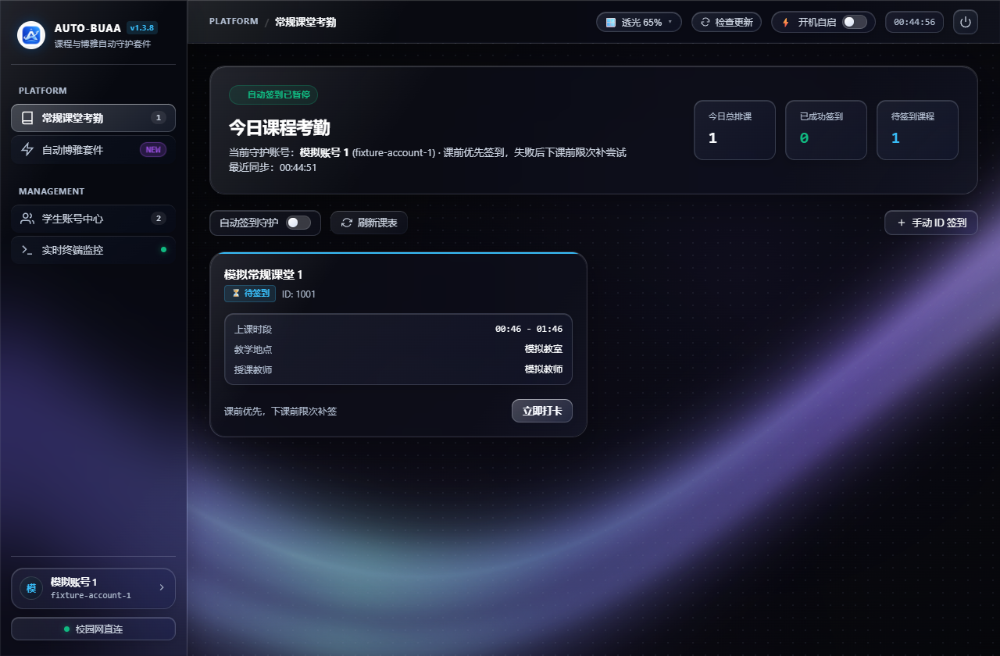
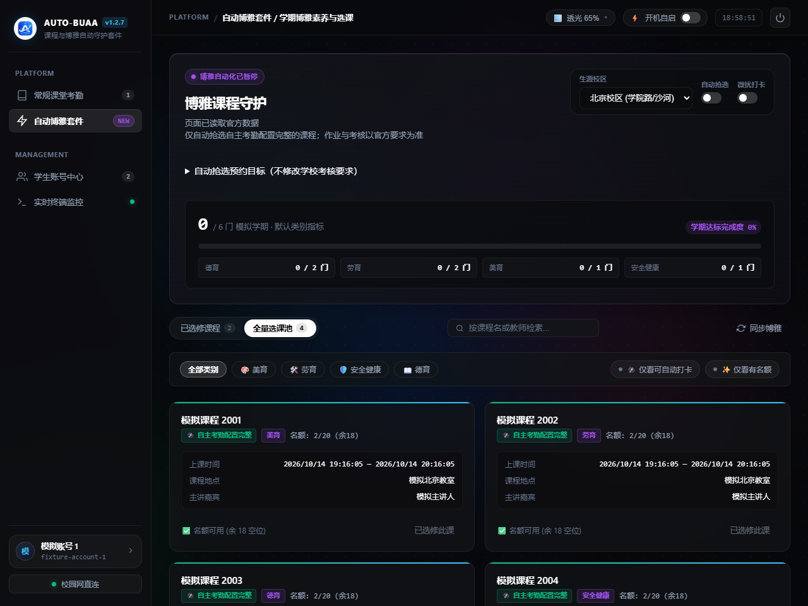
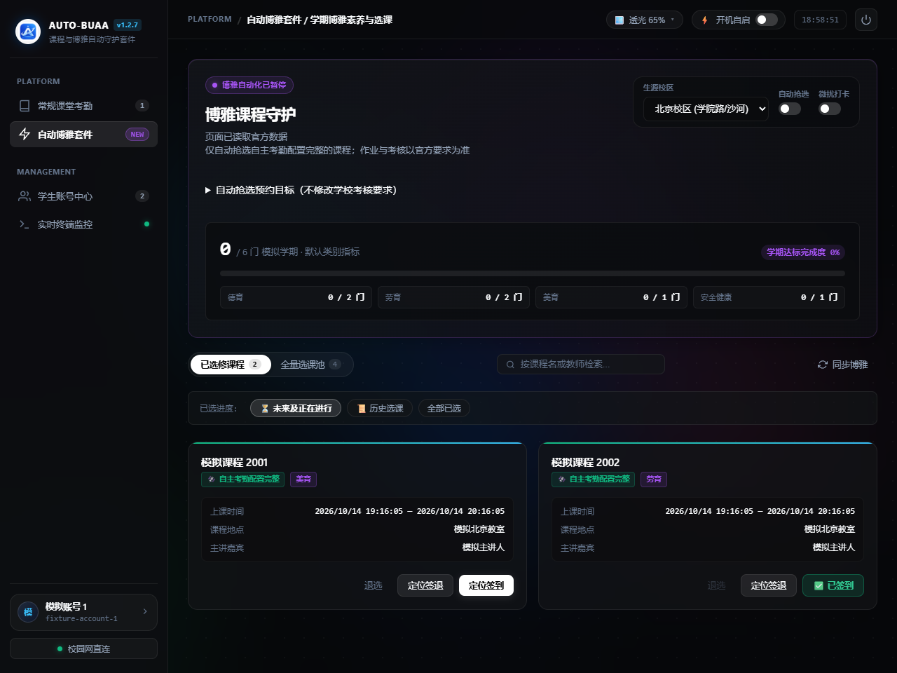
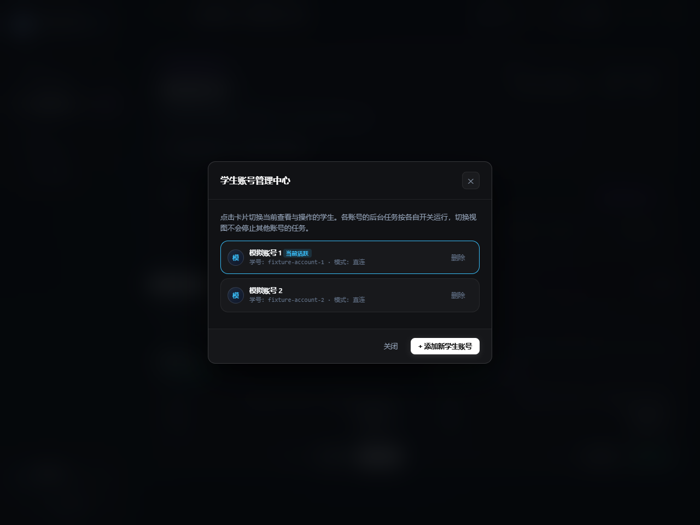
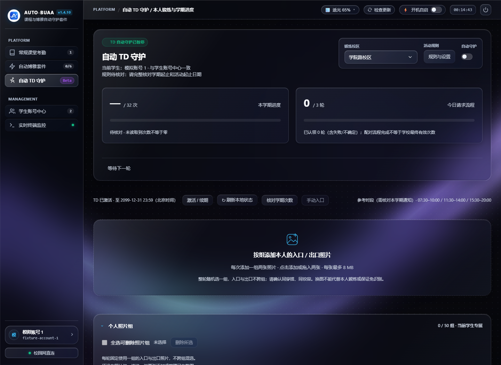
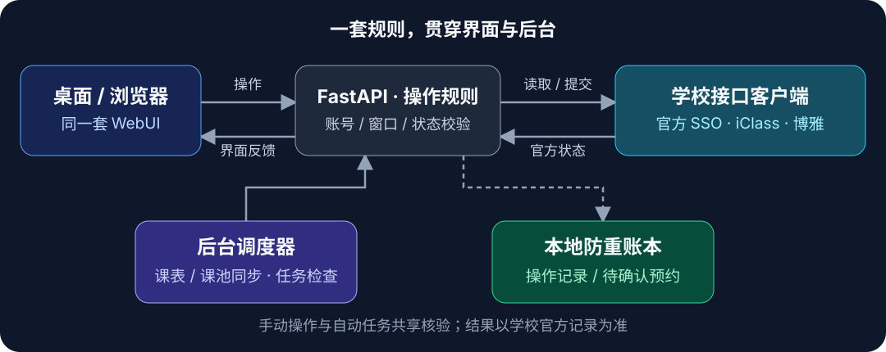

> [!CAUTION]
> **此软件只供学习相关网络知识及机制，请在24小时内删除。不得用于真实打卡、代签、伪造出勤或其他滥用；不得违反法律法规、校纪校规及相关平台规则。**
>
> **学号及操作记录可能被留存，滥用记录可能用于调查处理；相应后果依法自行承担。**
>
> 本提示不改变现有 MIT 许可，不保证绝对免责，也不免除法律规定不得免除的责任。下文展示的是技术实现能力，不构成向真实学校平台提交请求的许可。

<div align="center">


# AUTO-BUAA · 自动签到与抢课

## ⚡ 自动打卡 · 自动抢课 · 自动签到 · 自动签退

**开启任务，后台按规则自动执行。** 课堂与博雅一起守护，多账号独立运行。

[](https://github.com/nixianren666/AUTO-BUAATOOLS/releases/latest)
[](#下载与安装)
[](LICENSE)
[](https://github.com/nixianren666/AUTO-BUAATOOLS/releases)

[**⬇️ 下载客户端**](https://github.com/nixianren666/AUTO-BUAATOOLS/releases/latest) · [🖼️ 界面与功能](#界面展示) · [🛡️ 操作安全](#怎么减少漏选错选和重复操作)

源码版本 **v1.4.12**。各平台附件、构建信息和校验值请以对应的 [Release 发行页](https://github.com/nixianren666/AUTO-BUAATOOLS/releases/latest) 为准。

[⚠️ 使用前必读](#免责声明) · [🔐 账号隐私](#账号与隐私如何保护) · [🚀 三步上手](#第一次使用三步完成设置) · [⚙️ 后台部署](#源码与后台部署) · [💬 常见问题](#常见问题)

</div>

AUTO-BUAA 是面向北航学生的**开源自动签到与博雅自动抢课工具**。添加账号、核对设置并开启任务后，后台持续同步课表和课池，在允许的窗口内执行**常规课堂自动打卡、博雅自动抢课、自动签到与自动签退**，集中展示选课、考勤与学期进度。你可以在桌面使用，也可以部署为自己的后台服务，通过浏览器管理。

**适合希望减少重复操作、管理多个账号，并及时掌握官方课程状态的同学。** 程序协助管理，不替代课程参与、现场要求、作业和考核；考勤与最终达标请以学校官方记录为准。

---

<a id="免责声明"></a>

# ⚠️ 00 · 使用前必读：免责声明

> [!WARNING]
> **本项目不是北航官方产品，未获得学校认可或授权背书。使用自动化功能前，请确认学校及课程允许相应操作；不要把软件的“操作安全”理解为免审查、免风控或免处分。**

- **仅供学习研究，请在获取后24小时内删除。** 本项目用于研究代码、协议和界面实现；不得用于真实打卡、代签、伪造出勤或其他滥用。请在本地或受控 Mock 环境学习，不得将技术能力理解为对真实学校服务进行操作的授权。
- **遵守法律、校规与课程要求。** 使用者须遵守适用法律法规、学校管理规定、课程考勤要求及相关平台服务规则；不得以学习研究或开源许可为违规使用辩解。开源、可下载或技术上能够执行，不代表学校允许使用。
- **仅使用本人或已获明确授权的账号。** 不得盗用账号、冒用身份、伪造考勤、代替他人完成出勤，或通过异常请求、攻击、绕过访问控制等方式干扰学校及第三方服务。账号授权不能代替学校、课程和平台的许可。
- **学号与使用记录可能被保存。** 本机配置、日志及相关系统可能留存账号标识、时间与操作结果，滥用记录可能用于调查处理；本程序没有超过24小时自动上传、公开学号或自动举报的机制。是否构成滥用及记录的证据效力以事实和依法认定为准，删除软件也不代表相关记录必然消失。
- **违规行为及其后果由实际使用者依法承担。** 使用者自行决定是否安装、部署、开启任务及如何操作，并对账号授权、使用目的和具体行为负责。因违反法律、校纪校规、课程规定或不当使用产生的纪律处分、账号限制、学业影响、第三方索赔及其他后果，应由相应责任主体依法承担；开发者、维护者不提供违规使用的授权、担保或责任兜底。
- **课程参与责任仍在使用者。** 自动预约、签到或签退不能代替实际到场、现场考勤、作业及考核，也不能作为未到场的出勤证明。软件日志、界面状态和自动化结果均不构成学校认定出勤或考核通过的证明，请以学校官方记录为准。
- **不承诺抢课、考勤或达标结果。** 网络、设备休眠、认证失效、官方接口及规则变化都可能导致遗漏、失败或错误；时间随机化和位置微扰也不能保证自动化无法被识别。
- **开启前核对设置，运行后核对官方记录。** 请确认账号、校区、预约目标与任务开关；遇到“待确认”、异常或未同步时，先暂停相关任务，核实官网结果后再处理。
- **保护好自己的凭据和数据。** 自行妥善保管配置、密钥和日志；请勿提交账号密码、Token、Cookie 或未脱敏截图。使用非官方分发包、共享设备或远程服务时，还应核实来源和访问权限。
- **软件按现状提供，使用风险需自行评估。** 在适用法律允许的范围内，开发者、维护者不保证软件无缺陷、持续可用、适合特定用途或始终兼容官方接口，也不保证抢课成功、签到有效、学期达标或账号不受限制；相关担保及损失责任限制以 [MIT License](LICENSE) 为准。请自行核实使用条件、做好数据备份，并承担依法应由本人承担的使用风险。
- **许可与责任边界。** 本说明是风险提示与使用责任说明，不改变 MIT 许可，不增加与其冲突的许可限制；不免除法律规定不得免除的责任，也不排除使用者依法享有的权利。请在使用前完整阅读；不能接受相关风险时，请勿启用自动化功能。

**继续了解：** 看[界面演示](#界面展示) → 选[客户端下载](#下载与安装) → 按[三步上手](#第一次使用三步完成设置)设置。想放到服务器上运行，再看[后台部署](#源码与后台部署)。

---

<a id="界面展示"></a>

# 🖼️ 01 · 界面与功能

**先看界面，再看它能为你管理哪些事情。**

<div align="center">

</div>

*动图与截图来自程序实际 WebUI 的隔离演示，全部使用合成账号、课程与成绩，不含真实学生信息。*

<details>
<summary><b>📸 点击查看 5 张高清界面 · 今日课堂 / 博雅课池 / 已选课程 / 账号中心 / TD</b></summary>

**今日课堂：** 查看排课、签到状态和后台守护开关。



**博雅课池：** 类别筛选、名额、校区与本学期进度集中呈现。



**已选课程：** 分清签到、签退与考核状态，按官方条件开放操作按钮。



**账号中心：** 切换当前操作视图，保持其他账号的守护任务独立运行。



**TD（Beta）：** 查看本地配对流程、活动规则与个人分组图库；需为当前学生单独激活。以下为合成数据演示，配对完成不等于学校有效次数。



</details>

<a id="能帮你做什么"></a>

## ✨ 能帮你做什么

| 功能 | 使用体验 |
| --- | --- |
| 📅 **今日课堂自动同步** | 自动读取本人今日课表，显示课程时间、教室、教师与签到状态；支持刷新和指定排课 ID 签到 |
| ⏱️ **常规课堂自动打卡** | 课前十分钟内随机优先签到；失败后在下课前有限补尝试，发送前核实本人排课、官方时间与状态 |
| 🔎 **博雅课池自动同步** | 同步全量课池，按德育、劳育、美育、安全健康筛选，支持课程/教师搜索、校区及名额筛选 |
| 🎯 **博雅按目标自动抢课** | 各类别预约目标可单独设置；把已通过、已预约和待确认的课程纳入目标，减少重复抢选 |
| ✅ **博雅自动签到与签退** | 对有完整自主考勤配置的已选课程，依据教师开放窗口执行；手动操作和自动守护共用核验机制 |
| 📊 **学期与历史进度** | 区分本学期和历史课程，分别展示考勤、考核与最终通过；未知数据不会被填成达标 |
| 👥 **多账号后台自动守护** | 每个账号有独立开关和日志；切换当前界面不停止其他账号的后台任务 |
| 🏃 **自动 TD 守护（Beta）** | 复用学生账号，管理本人本地图库、入口/出口配对及学期进度；按活动日期和允许时段执行，结果不确定停止重发 |
| 🖥️ **后台常驻与日志** | 支持托盘、单实例唤醒和自启动；按学生、常规课程、博雅、TD 分类查看操作及异常 |
| 🎨 **清晰的桌面界面** | 深色卡片、动态背景、可调玻璃透光度与校徽描绘启动过渡；已完成、已过期或条件不足的操作有对应提示 |
| 🌐 **多种运行方式** | Windows 安装/便携版、Mac 双架构 App、Linux 桌面、Headless 服务与 Docker 部署 |

**TD 为 Beta 功能，按学生账号单独免费离线激活。** 每个新码仅核销一次，首次激活起一个自然月；仅到期前24小时或到期后可用新码续期。常规课堂与博雅无需激活。公开发行不包含维护者签发工具及任何私钥。请核对当学期官方 TD 活动规则；未确认规则、授权无效或结果不明时停止提交。详见[授权说明](docs/TD_LICENSE.md)。

默认预约目标为 **德育 2、劳育 2、美育 1、安全健康 1**，可按需求调整为每类 0–20 门；设为 0 表示不自动抢该类。这些数字是程序的预约目标，不能替代学校的培养与考核要求。

学校官网上已经选中的博雅课程也会同步到“已选修课程”。仅有有效自主考勤配置、本人已选且当前窗口开放的课程，才允许本程序执行对应签到/签退。

---

<a id="怎么减少漏选错选和重复操作"></a>

# 🛡️ 02 · 操作安全与提交约束

**时间、位置、身份和请求节奏都先核验，再提交。**

## ⏱️ 时间与位置：随机安排，也守住边界

| 机制 | 实际怎么做 | 约束什么 |
| --- | --- | --- |
| **完整签到窗口** | 手动可在开课前十分钟至本节下课提交；自动优先课前随机执行，失败后在下课前限次补尝试 | 读取与认证后核对官方时间，已下课不再提交 |
| **窗口内随机时间** | 在剩余有效时间内随机安排常规签到；能否发送仍以最后一次窗口核验为准 | 不把所有课固定在同一个预设秒数 |
| **博雅位置微扰** | 自动生成位置时，以官方签到点为中心，在有效半径内随机产生小幅偏移 | 不把每次提交的位置都写成同一个固定数值 |
| **位置再复核** | 写请求发送前检查经纬度合法性和距官方点的距离，必须落在允许范围内 | 随机化不能替代地点条件校验 |
| **限制重复提交** | 手动和自动共用防重账本；结果不明就暂停，常规课最多两组、每组三次实际提交 | 避免双击、并发或网络超时造成重复发包 |

这些随机化细节改变的是时间与坐标的生成方式。**当前坐标实现是圆内随机微扰，并非高斯采样，也不读取或证明设备真实位置。** 博雅签到/签退遵守各自的教师开放窗口，不套用常规课的十分钟规则。

> [!IMPORTANT]
> 窗口校验、防重和范围限制用于减少错误与重复操作；随机化不能证明学校无法识别自动化，也不能承诺免风控或免封。课程到场、现场考勤及学校使用规定仍须遵守。

## 🔄 持续发现新课和退课名额

博雅课池及已选记录每 **60 秒**同步，夜间也保持同步；后台每 **10 秒**检查操作窗口。自动抢选前会重新读取当前课池，避免拿启动时的旧名额提交。首次记录课池态势，后续重复信息静默处理；实际操作、故障和重要变化仍显示在日志中。

这能减少依赖旧缓存造成的遗漏，但不保证抢到所有课程：名额竞争、网络中断、认证失效和学校接口变化仍可能影响结果。

## 🎯 选课前，把条件核对清楚

| 自动抢选会核对什么 | 为什么需要这一步 |
| --- | --- |
| **本学期与所选校区** | 避免历史课和不匹配校区进入自动预约 |
| **官方选课窗口与剩余名额** | 未开放、已关闭、已满或容量不明时不提交 |
| **完整自主签到/签退配置** | 同时需要有效地点、半径及教师窗口；不会自动抢仅能现场刷卡/人工登记的课程，也没有放开此限制的开关 |
| **普通课堂、已选博雅与在途预约的时间** | 自动抢选比较三种时间冲突，避免刚抢到一门又撞上下一门 |
| **类别目标和已占用名额** | 目标已被已通过/预约/待确认课程覆盖时，停止额外抢选 |
| **课程本体 ID 与账号身份** | 按 ID 关联数据，不凭同名课程猜地点、窗口或选课身份 |

这些冲突、校区和类别目标保护针对**自动抢选**。手动选择也会检查最新课池、容量和选课窗口，但仍须自行核对课程适合度、时间冲突与参与要求。

## ✅ 签到前再确认，结果不明时先停住

- **常规课：** 仅本人北京时间当日排课，手动窗口为开课前十分钟至本节下课；自动首次优先安排在课前十分钟内的随机时间，失败后允许下课前有限补尝试。读取与认证完成后、实际发送前再次核对学校时间与课程归属。缺少可信下课时间时仅保留课前窗口，不推测课程时长；已下课或未选课程不能提交。
- **博雅课：** 仅本人已选，检查官方考勤状态、教师签到/签退窗口与地点配置；缺少有效条件就暂停，不按课程时间自行猜窗口。
- **共享防重：** 手动按钮与后台共用锁和持久操作账本，同账号、同课、同日最多两组、每组三次实际提交；组内间隔至少30秒，课前组间至少1分钟，上课后组间至少5分钟，巡检或网络耗时可能使实际执行更晚。跨开课时间按上课后的冷却重新核对，重启与切换手动/自动不会重置次数。成功即停；提交结果不确定时仅核实官方状态，不盲目补发。该限制是程序策略，不代表学校风控阈值，也不保证一定成功。
- **超时不盲重发：** 请求已经发送而结果不明时，显示待确认并保留记录。待确认选课继续占用预约目标与冲突位置，重启后也不会直接当作未选重抢。
- **官方确认后更新界面：** 区分“请求已提交”和“学校记录已确认”；签到、签退或时间经过都不直接算成考核通过。

---

<a id="账号与隐私如何保护"></a>

# 🔐 03 · 账号与隐私

**操作约束之外，账号凭据和管理入口也需要各自的保护。**

**业务在你的设备或你自己的服务上运行。** 项目不要求把账号交给开发者托管；统一认证、课堂与博雅业务通过学校官方接口完成，源码可以公开审查。

| 保护机制 | 实际含义 |
| --- | --- |
| **HTTPS 与可信目标检查** | SSO、课堂与博雅的 HTTPS 通信验证 TLS 和可信目标，检查 WebVPN 内层地址；TD 旧 TCP 协议没有 TLS，不能视为端到端加密 |
| **记住密码时加密保存** | Windows 使用当前用户 DPAPI；Mac/Linux 使用可用系统凭据库，或当前用户独占的随机密钥加密，避免明文配置 |
| **会话只留在进程中** | Cookie/Token 用于业务访问；退出释放本地会话资源，但不代表学校已吊销所有凭据 |
| **本地管理默认回环** | 默认访问 `127.0.0.1:18346`，管理 API 有会话、Host/Origin 和 CSRF 检查；远程部署还需要独立管理密码 |
| **异常不覆盖秘密** | 密钥或配置读取失败时保留原文件并提示处理；不会为“恢复登录”把密码转存为明文 |
| **公开分发与个人配置分开** | 发布包不附带开发者/测试账号配置；源码与发布内容经过敏感信息检查，展示画面使用合成数据 |

界面会请求 Google Fonts 字体资源；受限网络下回退系统字体。学号和密码不会被拼入字体请求参数。后台学校业务不继承系统环境代理。

自己的配置、加密密钥和日志仍应妥善保管。迁移设备后，受原系统用户保护的密码可能需要重新输入；反馈问题时请遮住学号、姓名、Cookie、Token 和个人课程信息。

---

<a id="下载与安装"></a>

# 💻 04 · 下载与安装

> [!TIP]
> 只想直接使用？选择下面的桌面安装包即可，不需要阅读源码或后台部署章节。

**优先从本仓库的 [GitHub Releases](https://github.com/nixianren666/AUTO-BUAATOOLS/releases/latest) 下载。** 每次发行提供对应平台的程序和 `SHA256SUMS.txt`，便于核对文件是否完整、是否与发行内容一致。

| 平台 | 发行页中的文件格式（X.Y.Z 为对应版本） | 怎么选 |
| --- | --- | --- |
| Windows x64 安装版 | `BUAA-Signin-Setup-vX.Y.Z.exe` | 推荐日常使用，带安装向导、快捷方式和卸载入口 |
| Windows x64 便携版 | `BUAA-Signin-vX.Y.Z-portable.exe` | 希望免安装，放入自己的工具目录直接运行 |
| Mac Apple Silicon | `BUAA-Signin-vX.Y.Z-macOS-arm64.dmg` / `.zip` | M 系列芯片选 arm64 |
| Mac Intel | `BUAA-Signin-vX.Y.Z-macOS-x86_64.dmg` / `.zip` | Intel 芯片选 x86_64 |
| Linux x86_64 | `BUAA-Signin-vX.Y.Z-Linux-x86_64.tar.gz` | 桌面或无界面的 Linux 设备 |
| 源码 | `AUTO-BUAATOOLS-vX.Y.Z-source.zip` | 自行运行、部署或开发；也可克隆仓库 |

**跳到你的平台：** [🪟 Windows](#windows安装) · [🍎 macOS（含首次打开提示）](#macos安装) · [🐧 Linux](#linux安装)

<a id="windows安装"></a>

## 🪟 Windows · 安装版 / 便携版

1. 安装版双击 Setup 按向导安装；便携版放进可写目录后直接运行。
2. 添加账号，按当前网络选择“校园网直连”或“WebVPN 外网通道”，等待常规课堂与博雅分别完成认证。
3. 确认校区、预约目标和各项自动任务开关，再按需求开启守护。

安装、升级和卸载保留个人配置及无关文件。配置可能位于程序旁或 `%APPDATA%\BUAA-Signin`，取决于已有配置与目录可写性；不要把自己的配置分享为安装模板。重复打开同一配置会唤醒已有实例。

<a id="macos安装"></a>

## 🍎 macOS · 双架构安装与首次打开

1. 在“关于本机”确认是 Apple 芯片还是 Intel，下载对应架构。
2. DMG 打开后把 `BUAA-Signin.app` 拖到“应用程序”；ZIP 解压后也可把 App 移入该目录。
3. 启动 App，添加账号并检查认证状态。通常配置保存在 `~/Library/Application Support/BUAA-Signin`。

### 🔓 首次打开：提示“无法验证开发者”怎么办？

当前 Mac 应用采用本地签名，尚未经过 Apple 公证，首次打开可能出现门禁提示。确认文件来自本仓库 Release、摘要与发行清单一致后，可以只允许这个 App：

1. 先尝试打开一次 App。
2. 进入 **系统设置 → 隐私与安全性**，找到这次被阻止的 App，选择 **仍要打开**。
3. 按系统提示再次确认打开；后续通常可正常启动。

这为该 App 创建例外，无须关闭整个系统的门禁。步骤参考 [Apple 官方首次打开说明](https://support.apple.com/zh-cn/102445)。

如果提示“已损坏”或明确检测到恶意软件，先重新下载并核对摘要，附上已脱敏的提示提交 Issue；不要把所有安全提示一律当成可忽略的签名问题。

<a id="linux安装"></a>

## 🐧 Linux · 桌面 / Headless

解压发行包，在程序目录运行：

```bash
tar -xzf BUAA-Signin-vX.Y.Z-Linux-x86_64.tar.gz
chmod +x BUAA-Signin
./BUAA-Signin
```

桌面版需要可用图形会话和 Qt6 对应系统库。Ubuntu/Debian 可按缺库提示安装，例如：

```bash
sudo apt-get install libegl1 libopengl0 libgl1 libxcb-cursor0 \
  libxcb-icccm4 libxcb-image0 libxcb-keysyms1 libxcb-shape0 \
  libxcb-render-util0 libxcb-xinerama0 libxkbcommon-x11-0 libpulse0
```

无桌面的服务器可直接运行：

```bash
./BUAA-Signin --headless --host 127.0.0.1 --port 18346
```

然后访问 `http://127.0.0.1:18346`。Linux 通常使用 `~/.config/buaa-signin/config.json`；已有程序旁/当前目录配置可能优先使用。当前 Linux 二进制为 x86_64，其他架构请按源码方式自行适配。

---

<a id="第一次使用三步完成设置"></a>

# 🚀 05 · 第一次使用：三步上手

**这一部分讲软件里的设置，不涉及服务器部署。**

首次进入需勾选免责声明，并在“条例二 · 本人承诺”中完整输入所示承诺；两项均确认后才能继续。此前仅勾选过免责声明的用户需补签一次。同版确认只在本地保存确认版本和时间，不保存完整输入。

| 👤 第一步：接入账号 | 🎛️ 第二步：选择任务 | 📋 第三步：核对结果 |
| --- | --- | --- |
| 添加账号，查看常规课堂与博雅各自认证状态；按当前网络选择校园网直连 / 官方 WebVPN，验证码手动处理 | 核对校区与预约目标，再分别开启常规签到、博雅抢选、博雅签到签退 | 查看今日课堂、已选课程和分类日志；遇到未同步或待确认，先核对官网 |

**切换当前账号只切换视图，不会暂停其他账号的后台任务。**

开启任务但配置保存失败时，程序撤回开启；暂停仍立即生效。若暂停后出现未保存提示，请重新保存，避免重启沿用磁盘里的旧开关。

---

<a id="源码与后台部署"></a>

# ⚙️ 06 · 源码与后台部署

**进阶使用：自己运行源码，或把程序放到长期在线的设备上。**

选择适合你的方式：[**A · 源码运行**](#源码运行) · [**B · 用户后台服务**](#用户后台服务) · [**C · Docker / NAS**](#docker部署)。安装包用户按前面的“三步上手”设置即可，也可以直接查看[常见问题](#常见问题)。

<a id="源码运行"></a>

## 🧑‍💻 A · 源码运行与虚拟环境

推荐 Python 3.12，使用独立虚拟环境。Windows 使用 `.venv\Scripts\python.exe`，Mac/Linux 使用 `.venv/bin/python`：

```bash
git clone https://github.com/nixianren666/AUTO-BUAATOOLS.git
cd AUTO-BUAATOOLS
python -m venv .venv
```

| 系统 | 安装依赖 | 启动 |
| --- | --- | --- |
| Windows | `.venv\Scripts\python.exe -m pip install -r requirements.txt` | `.venv\Scripts\python.exe run.py` |
| Mac/Linux | `.venv/bin/python -m pip install -r requirements.txt` | `.venv/bin/python run.py` |

Linux 源码桌面模式还需安装 `.venv/bin/python -m pip install 'pywebview[qt6]==6.2.1'` 和前述图形库。仅 Headless 运行可使用 `.venv/bin/python run.py --headless`。系统只有 `python3` 命令时，用 `python3 -m venv .venv` 创建环境。

需要隔离多个部署时，使用 `--config /你的路径/config.json` 或 `BUAA_CONFIG_FILE` 指定配置。加密密钥也应随部署妥善保存。

<a id="用户后台服务"></a>

## 🔧 B · Linux / macOS 用户后台服务

先完成上面的源码依赖安装，再以实际使用账号运行服务脚本，**不要 sudo/root 安装用户服务**：

```bash
# Linux
bash scripts/install_linux_service.sh install
bash scripts/install_linux_service.sh status
bash scripts/install_linux_service.sh logs

# macOS
bash scripts/install_macos_service.sh install
bash scripts/install_macos_service.sh status
```

两套脚本均支持 `start / stop / restart / status / uninstall / update`；Linux 的 `logs` 跟随 journal，Mac 操作日志请在软件界面查看。卸载服务保留配置。

Linux 单元为 `buaa-signin.service`，Mac LaunchAgent 为 `com.buaa.signin`。它们以当前用户运行、默认监听回环地址。无人值守、退出登录后继续运行或开机尚未登录时运行，取决于系统用户服务环境；不是勾选自启就能保证。

`update` 校验本项目 Git 来源、拒绝覆盖本地源码修改，只切到当前程序指定的固定发行标签，**不是自动追踪 main 或未来版本**。升级到新版本时请先查看对应 Release 的升级说明。

<a id="docker部署"></a>

## 📦 C · Docker / NAS 与远程访问

在已安装 Docker 的设备上，在仓库目录使用 Compose：

```bash
# 在当前 shell 设置一个独立的应用管理密码，不要使用学校密码
export BUAA_ADMIN_PASSWORD='换成你自己的独立管理密码'
docker compose up --build -d
docker compose logs -f
```

PowerShell 使用 `$env:BUAA_ADMIN_PASSWORD = '你的独立管理密码'` 设置环境变量。配置、加密密钥、TD 私有数据及容器安装标识保存在 `buaa-profile` 持久卷；镜像不复制开发者个人配置，容器以非 root 用户运行。升级请保留整个卷和原管理密码，**不要使用 `docker compose down -v`**。容器没有系统机器标识时使用 `/data/.td-device-id`；它属于私有安装数据，不能放进镜像、Git 或发给他人，也不等同于硬件防复制。

默认只映射宿主机回环 `127.0.0.1:18346`，本机浏览器访问即可。远程服务器优先通过 SSH 隧道访问：

```bash
ssh -L 18346:127.0.0.1:18346 你的用户@你的服务器
```

在自己电脑打开 `http://127.0.0.1:18346`。若要直接远程开放，必须配置独立管理密码、`BUAA_ALLOWED_HOSTS`，并自行设置 HTTPS 和访问控制；请勿在不可信网络明文传输管理密码。反向代理应保持正确的 Host、协议与同源地址，不提供跨域管理接口。Windows 客户端本身不需要 Docker 或 WSL。

**浏览器与桌面的操作区别：** 设置管理密码的服务先显示“登录应用管理”卡片，通过后再加载首次声明和账号。有效管理会话在刷新网页后可复用；过期或服务重启时重新登录。失败的操作不会因重新登录而自动重复提交，请先核对结果。服务器网页的“退出管理”只退出当前浏览器会话，后台任务继续；服务启停、自启动由 Docker / systemd / launchd 管理，网页不修改宿主机自启动。桌面原生窗口仍保留本机退出与自启动入口。

**开屏与服务生命周期：** 每次服务进程启动后，仅首次请求首页的页面获得一次开屏动画，所有浏览器共享这个批次；刷新、关页重开、切账号和管理登录不会重播。服务或容器重启、电脑重启后的新进程会重新获得一次，包括开机自启。中途关闭页面不会重播；预取不消耗机会，减少动态效果时直接进入界面。健康检查请使用 `/api/health`，不要用首页探测消耗首次展示机会。首次声明的确认记录独立保存，开屏播放与否不会绕过确认。

---

<a id="项目怎么工作"></a>

# 🧩 07 · 项目结构与原理

**一套规则，连接桌面界面、后台调度与学校业务接口。**

桌面窗口与浏览器使用同一套 WebUI。FastAPI 汇总各账号状态，后台调度器定期读取课表/课池；手动操作与自动任务在共享规则和账本下执行。统一认证连接学校 SSO，校园网直连或官方 WebVPN 提供对应业务通道。



## 📂 源码目录与模块职责

```text
AUTO-BUAATOOLS/
├── run.py                      # 桌面 / Headless 统一启动入口
├── core/
│   ├── cas.py / webvpn.py       # SSO 与官方 WebVPN 认证通道
│   ├── iclass.py               # 常规课堂排课与签到
│   ├── boya_client.py          # 博雅官方数据和提交接口
│   ├── domain.py               # 身份、日期、状态与窗口契约
│   ├── boya_actions.py         # 手动 / 自动博雅操作预检
│   ├── operations.py           # 持久防重与待确认预约账本
│   ├── scheduler.py            # 常规课堂后台调度
│   ├── boya_scheduler.py       # 博雅同步、选课与考勤调度
│   ├── vault.py / profile.py   # 凭据保护与配置位置
│   └── autostart.py            # 跨平台自启动
├── server/
│   ├── app.py / management.py  # API、账号管理与管理面会话
│   └── static/                 # HTML / CSS / JavaScript 桌面界面
├── scripts/                    # 用户服务、构建与验证脚本
├── tests/                      # 规则、边界、并发与界面回归
├── installer/                  # Windows 安装包定义
├── docs/images/                # 合成数据界面截图与演示动图
├── config.example.json         # 空白配置示例；个人 config.json 不提交
├── requirements.txt            # 源码运行依赖
└── Dockerfile / docker-compose.yml
```

---

<a id="常见问题"></a>

# 💬 08 · 常见问题

**按问题查答案，避免在长段落里寻找关键说明。**

## 🔑 为什么登录成功，却暂时没有常规课或博雅数据？

统一认证和两个业务系统的授权分开完成；查看各自状态及日志。失败时保留上次成功数据并标记未同步，不会拿演示课程填充你的账号。

## 🎯 为什么有名额也不自动抢？

可能不在选课窗口、不是本学期/所选校区、类别目标已占满、存在时间冲突，或没有完整自主考勤配置。数据无法核实也会暂停；请按日志说明核对。

## 📊 为什么已经签退，学期完成数还是没增加？

签退只是考勤记录的一部分，最终通过依学校考勤与考核字段判定。作业、现场参与、考核审核等仍可能尚未完成。

## ✅ 为什么某些课不能自动签到/退选？

老师未开放窗口、考勤配置不完整、已有记录或课程已结束都会限制操作；线下刷卡/人工考勤需要按学校要求参与。已记录考勤、已通过或已结束的课不在程序中退选。

## ✨ 怎样调节玻璃效果和检查软件更新？

源码候选界面的“透光”面板支持 **1%–90%** 调节，自动记住本机偏好；原有65%默认值保留。顶部“检查更新”可手动查询本项目GitHub最新正式版，也可在面板里关闭每天一次的后台自动检查。发现新版本后可前往发行页查看说明、选择适合的平台附件；软件不会静默下载、安装或重启。离线与GitHub限流只影响本次检查，不影响签到与抢选；本地候选高于已发布版时不会要求降级。当前已发布客户端下载仍以发行页实际版本为准。

## 🏃 TD 怎样使用？照片和次数如何处理？


本地候选的左侧 **自动 TD 守护** 使用学生账号中心的当前账号，不再索要 TD 密码，也不会把统一认证密码发送给 TD。先导入本人的照片，在“规则与设置”核对当前学期官方活动日期、校区和目标，再主动开启。TD 只使用校园网专用通道，课堂登录的 WebVPN 通道不会自动适用于 TD。

**TD 离线激活仅为防止滥用所设，本软件一切功能开源免费、非营利，不收取软件或激活码费用；仅供学习相关网络知识及机制，请在24小时内删除。** 在“激活 / 续期”生成当前学号的本机申请码，交由维护者通过独立生成器免费签发，再粘贴激活码。每个学生账号须单独激活 TD，其他账号不会被同时激活。授权从首次激活起一个自然月，绑定当前学号与本机；同一码成功使用后立即永久核销，不能重复续期或转给其他账号、电脑。仅在到期前24小时或到期后可申请并使用新码续期；提前续期从原到期时间顺延一个自然月，不扣掉剩余时间。申请与验证离线进行，不自动上传申请码，不影响常规课程及博雅功能。未激活或已到期时，点击自动 TD 只显示离线激活卡片，激活成功后才进入 TD 页面；可返回常规课堂，其他功能不受影响。

离线授权依赖本机状态与系统时间，不能保证抵御管理员修改程序或恢复整个系统备份；更换系统/电脑或授权存储不可验证时需联系维护者。一个月是技术授权期限，不放宽仅供学习及24小时内删除的使用提示，也不改变现有MIT许可。详见[离线授权使用与维护](docs/TD_LICENSE.md)。

图库按学生隔离，仅保存在当前配置文件旁的私有目录。**每次添加一组，两张分别标为入口、出口**，由用户确认是本人、穿搭与妆容一致；保存后可继续添加下一组。程序不自动识别衣着。一轮固定使用同组照片，多组时随机选择并避免紧接着复用上一组；不会把不同组的入口与出口混用。旧散图保留，可手动组成照片组，未分组照片不会用于新一轮。支持重复识别、缩略图和按组删除，正在配对或待核验的组不能删除；解码后去掉 EXIF 并重新编码。移除账号会停止守护，但不擅自删除图库。照片轮换不是免识别保证，更不能代替本人参与锻炼。

先核对学期起止，再填写其中的活动日期；已有同步官方校历时，学期边界还须与它一致。没有官方校历时，手动日期会明确标为待本人核对，不代表学校确认。开放星期需要逐项确认，可补充临时停开日期；界面中的每日时段来自已公开通知的参考安排，仍需核对本学期通知。未确认规则时不提交，天气及临时关闭需主动暂停。修改活动日期不会清空当天请求预算。

**手动 TD 与连续队列：** 暂停自动守护后，点击“手动 TD”并确认，一次启动当天剩余的入口→等待→出口队列，最多三轮；已认领的轮次不会因切换方式而重置。步骤之间保留3–4分钟等待，执行中和时段外按钮置灰；剩余开放时间不足完整队列时不启动。自动守护在允许窗口内随机安排一次首次入口，随后按同样间隔连续执行当天队列。页面显示正在入口、已入及等待出口秒数、正在出口、已出及等待下一轮秒数；这只是请求进度，不是最终审核结果。刷新、切换账号或关闭网页不会重复创建或停止后台队列；可用“暂停后续队列”停止后续请求，在途结果仍需核对。持久状态支持同一窗口内安全恢复，过期配对、重启前未确认的发送或未知响应不重放。请实际参与并核对当学期规则，不将随机化视为免风控保证。

学期次数标明“服务器返回”或“手动核对”及更新时间，未知显示“待核对”。刷新只查本地状态，不偷偷发一次入口打卡来获取次数。当前未取得可验证的只读 TD 次数接口；“核对次数”提供学校健康云入口，再由本人填写核对值。体育部已公开通知说明次数约每24小时更新一次，不能把一次配对完成当作已通过审核。本地今日进度表示本软件的配对请求流程，**不等于学校最终有效次数**，也不包含其他设备或线下操作。入口至出口限制七分钟内，本软件每日最多三轮（失败、结果不明也占用本地预算）；请勿与其他客户端并用。网络结果不确定、重启遗留请求或配对过期会停下等待核对，不自动重放。

TD 旧协议没有 TLS；照片会在执行对应请求时发送给学校服务，学校最终照片审核、有效记录和体育要求以官方为准。当前候选不宣称完成真实学校提交或全部平台原生验收。

## 💤 退出或休眠后还能工作吗？

程序彻底退出、设备关机或休眠时无法继续发请求。需要持续后台守护，应保持设备、网络和用户服务可用，并定期核对官方结果。

## 🛠️ 遇到问题怎么反馈？

在 [GitHub Issues](https://github.com/nixianren666/AUTO-BUAATOOLS/issues) 提供系统/架构、程序版本、操作步骤和脱敏后的提示即可；不要上传个人配置、账号密码、Token 或未遮挡的个人截图。

---

<a id="开源贡献与致谢"></a>

# 🤝 09 · 开源、贡献与致谢

**一起改进使用体验，也保留可公开审查的实现。**

代码以 [MIT License](LICENSE) 开源。欢迎反馈界面体验、协议兼容和规则边界问题，也欢迎提交改进。

机制研究与实现参考 [BUAASubnet/UBAA](https://github.com/BUAASubnet/UBAA)、[DeNeRATe-cool/AutoBoya](https://github.com/DeNeRATe-cool/AutoBoya) 及 [AutoTD](https://github.com/DeNeRATe-cool/AutoTD)，感谢上游的协议探索。TD 参考协议和设备映射的许可见 [第三方声明](THIRD_PARTY_NOTICES.md)，未接入其遥测或云端账号系统。本项目不是学校官方产品，与上游项目也不是同一个客户端。

启动动画使用的校徽与校名字形来自 [THN-BUAA/BUAA-Logo](https://github.com/THN-BUAA/BUAA-Logo)，素材来源记录见 [图形素材说明](server/static/images/BUAA_LOGO_SOURCE.json)。学校标识及相关权利归相应权利人所有，不表示本软件获得学校认可或背书。

**版本变化、修复内容与升级说明，请看 [Releases](https://github.com/nixianren666/AUTO-BUAATOOLS/releases)。** 开发与验证资料在 [docs/handoff](docs/handoff/README.md)，供参与开发时查阅。

请遵守学校的账号、课程出勤和选课规定。程序无法承诺百分之百抢课、免封或学期达标；网络、设备、学校规则与官方接口的变化都可能影响结果。

<div align="center">
<sub>Built for BUAAers · 开源、可审查，在自己的设备上运行</sub>
</div>


### VPN、系统隧道与网络切换

“校园网直连”表示请求校方原始地址，“WebVPN”表示使用学校网页网关；两者都由系统路由决定最终出口，不表示能绕过第三方VPN/TUN。关闭HTTP代理也不代表系统隧道已关闭。软件保持TLS证书校验，不自动修改系统路由、DNS、VPN或强制全局IPv4。

短暂断网、DNS/连接/读取失败或未知课表响应会保留上次数据并标记未同步；不能据此认为没有课程、已经签到或登录必然失效。仅明确的认证失效响应进入已有认证退避；博雅Cookie交换遇到网络失败不会立即追加密码登录。网络恢复后再进行只读同步；不重放结果不确定的学校写入。

若开启系统隧道后请求失败，请核对隧道客户端对学校认证、UC、iclass、博雅及学校WebVPN域名的分流、DNS和端口可达性。TD的校内TCP连接与学校WebVPN网页通道不同，不能据此推定可达。反馈时提供软件版本、发生时间和脱敏错误类型即可；拓扑快照本身不足以确认具体原因。
