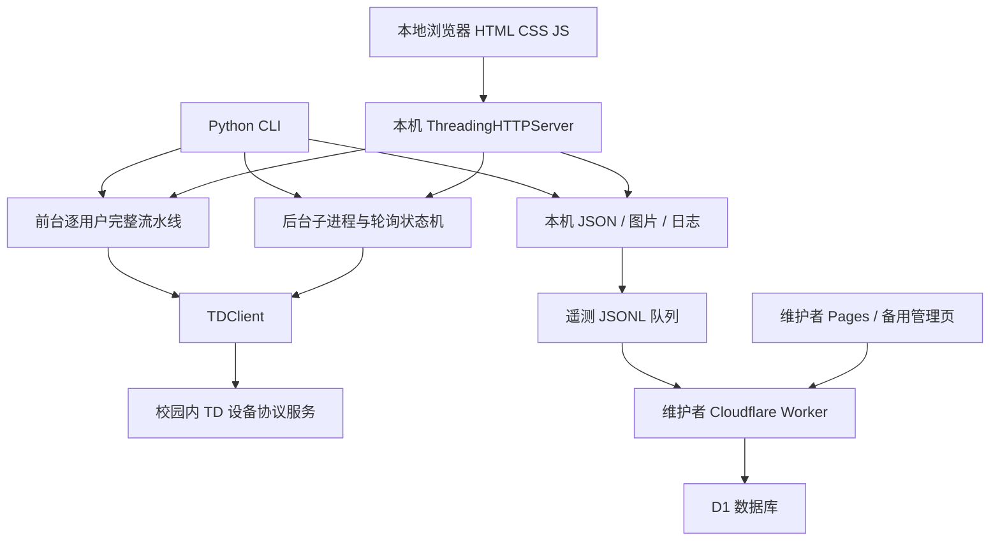

# AutoTD：机制、架构与完整逻辑链审查

审查日期：2026-10-19。用户要求独立、详细理解 AutoTD，暂不接入 AUTO-BUAATOOLS，不修改现有业务或美术。本报告基于实际取得的发行源码和可达历史，不沿用其他项目的推断。

配套：[风险审查](AUTOTD_REVIEW.md)、[逐文件/逐函数索引](AUTOTD_CODE_INDEX.md)、[机器证据](autotd_audit_evidence.json)。

## 1. 审查对象与证据边界

| 对象 | 固定版本 | 实际内容与用途 |
|---|---|---|
| GitHub 当前默认分支 `open` | `a4c6e9b10867d970bf31d730b28673244e7cc433`，2026-09-18 | 当前树只有 README；唯一公开分支；未见 Release 或标签。不能仅看首页宣称读完源码。 |
| PyPI 实际发行程序 | `autotd-buaa 0.1.15`，2026-05-27 | wheel 与源码包内 20 份程序/资源文件逐字节相同；15 个 Python 文件、194 个函数/方法定义（含内部函数）。本地 UI 也在这里。 |
| 历史完整树 | `99fd3656d1386eee2ea0d3071b7e16bdd2e59fe6`，2026-05-17 | 保留 Cloudflare Worker、D1 SQL、Pages 管理台、历史 CI 和 MIT 许可。取回相关 16 份源码/说明，不读取部署方私有文件。 |

发行包 SHA-256：

- wheel：`7eb8471a732403754c578f11a339fbb46e3f674388040d2add25d4187fff08d4`。
- sdist：`e0519f2863ab4ee83ce752f0c565c91d62d2d66fd16229e028c713f1037b33af`。
- wheel 的 24 条非空 RECORD 摘要/大小匹配。此处证明下载与包内内容一致，不等于发布者数字签名或无缺陷保证。
- 13 份发行文件还与该历史树的 Git blob 完全相同，其中包括 `client.py`、`scheduler.py`、`runner.py`、`telemetry.py` 和协议模板。后加入的本地 WebUI、修改后的 CLI/storage 以发行包为准。

GitHub 后续 README 更新了说明，没有让 PyPI 源码自动变成 9 月版本。历史 Cloudflare 源码也不等于已经核实当前线上部署内容。学校真正处理 TD 的服务端源码不在这些资料中。

可复核来源：

- [当前 README 固定提交](https://github.com/DeNeRATe-cool/AutoTD/blob/a4c6e9b10867d970bf31d730b28673244e7cc433/README.md)
- [PyPI 0.1.15](https://pypi.org/project/autotd-buaa/0.1.15/)
- [0.1.15 完整源码包](https://files.pythonhosted.org/packages/d8/39/e22c6552f6e14d737fe03b6c35ff1a8b4c0c85668caac8cf52eddd472b6f/autotd_buaa-0.1.15.tar.gz)
- [历史完整树](https://github.com/DeNeRATe-cool/AutoTD/tree/99fd3656d1386eee2ea0d3071b7e16bdd2e59fe6)

## 2. 它实际是什么

AutoTD 是体育 TD 线设备报文的 Python 客户端及流程管理器。它不使用本项目的 CAS/SSO 登录、博雅课池、课程排课 ID 或 GPS 坐标模型；不能套用 UBAA 的课前十分钟和博雅签到签退规则。

它有三套不同性质的前后端：



学校请求、遥测请求、本机管理请求是三条独立通道。云端统计平台不负责代替本机向学校打卡，也不是学校的官方成绩平台。

## 3. 安装、入口与存储

`pyproject.toml` 声明 Python >=3.10，入口为 `autotd = auto_td.cli:main`，运行依赖未列出第三方包；构建使用 setuptools/wheel。当前包自标 Alpha。它不是原生桌面安装器、系统服务或跨平台托盘程序。

`paths.get_app_home()` 优先读取 `AUTOTD_HOME`，否则使用当前用户的 `~/.autoTD`。这与我们的 `ubaa/config.json` 无关。本轮所有执行均定位到审查专用临时目录。

| 文件/目录 | 内容 | 关键限制 |
|---|---|---|
| `config.json` | 学校/事件编号、服务器、设备机位模板 | 机器配置是静态模板，没有自动获取新机位或核实当前设备状态。 |
| `users.json` | 用户标识、卡号、入口/出口、图片、轮数、等待区间 | 按用户标识覆盖存储，不是账号认证或所有权证明。 |
| `settings.json` | 轮询间隔、日内窗口 | 不包含学期校历和特殊日历。 |
| `state.json` | 缓存次数、每日阶段、遥测开关/实例密钥 | 多类状态共用一个 JSON，无事务/跨进程锁。 |
| `images/` | 用户导入的原始文件 | 不校验解码、归属、EXIF 或是否为本人照片。 |
| `telemetry_queue.jsonl` | 待上报事件 | 包括明文用户标识，失败积压没有上限。 |
| `autotd.pid` | 后台 PID | 不是系统互斥锁，也没有进程身份或启动时间校验。 |
| `logs/` | 按日期滚动日志 | 包含用户标识、设备 ID、服务端消息和异常，未脱敏。 |

初始化会创建目录和缺省文件；旧默认 `127.0.0.1:8888` 会被迁移至模板服务器。导入旧项目会复制配置、图片、解析旧 JSONL 用户并保存；不能将其误当“不覆盖既有用户”的安全合并：导入末尾会保存新构造的整个用户字典。

存储层 `_write_json()` 直接以写模式打开目标文件，未采用临时文件原子替换、版本比较或文件锁。文件访问权限采用操作系统继承值，代码没有专门加密/收紧权限。不能由此断言所有机器上文件均对其他用户公开，但也没有软件级的额外保护。

## 4. 用户模型、Quick 配置与图片

`User` 为不可变 dataclass，字段包括用户标识、卡号、入口/出口机位、两张图片文件名、轮数和等待范围。缺省为 3 轮、等待 180–240 秒；卡号缺失时通过数字用户标识作十六进制转换得到。

模型验证了必填、整数转换、轮数大于零、等待非负及最小值不大于最大值。`AppStorage.validate_user()` 还检查机位 ID 存在和图片存在。

由标识生成的十六进制卡号是可逆编码，不是加密，也不能视为持有本人账号的证明。

它没有证明：用户拥有该标识、卡号与该用户匹配、机位方向正确、两机位同一校区、图片是正确的人、等待足以满足全部规则。显式给出卡号时，用户标识可以不是纯数字；机位存在也不等于入口/出口方向正确。

参数校验没有把轮数强制限制到每日最多三次，也允许等待范围为零或超过七分钟；“默认值看起来合理”并非业务规则被完整实现。跨执行入口还会重复消耗当天轮数。

Quick 模式将“沙河/学院路/本部”等别名标准化，从配置中分别过滤入口与出口机位，再随机选机位和图片。选择发生在**新增用户时**，保存后固定使用，并不是每次请求都随机换设备或图片。

图片池是所有用户共享的目录；Quick 没有按用户绑定照片，入口和出口也可能选中同一张。方向判断使用 `doortype` 或位置文字二者之一，配置本身矛盾时仍可能入池。

CLI 同时允许 Quick 与 `--rounds`/等待参数，但 Quick 分支并未将这些参数传入构造函数，仍得到缺省 3 轮/180–240 秒。此差异已实测。

## 5. 学校通信协议与返回判定

对应发行源码 `client.py:17–151`。默认配置目标为校园内 `10.212.28.38:8888`，使用 IPv4 TCP socket，每个请求新建连接。不是浏览器 HTTP API，也没有 CAS、Cookie、密码登录或 WebVPN 转发实现。

“校园网”在源码里主要体现为该地址的可达性，没有识别/拒绝所有 VPN 的逻辑。README 的校园直连说明、旧错误提示的 VPN 建议与健康云网页的 VPN 查询应分开看；具有 TCP 路由的 VPN 和网页代理不是同一条件，不能仅凭此代码保证 VPN 可用或一概不可用。

报文是 5 字节大端头（正文长度与请求类别）加正文。打卡正文是包含用户/卡号、毫秒时间戳、学校/事件编号和机位编号/序列号的 JSON；图片正文是设备序列号、同类时间标识和原始图片字节的组合。两类报文分别处理，客户端未将其合成一个原子操作。

`request()` 设置 socket 超时，使用 `sendall`，精确读满响应头和响应体，检查响应类别一致、长度正数，再解析 UTF-8 JSON。这些是实际存在的正确性保护。

同时，没有 TLS、服务端证书验证、打卡报文 HMAC/签名、客户端挑战应答或响应体大小上限。超时是 socket 操作级超时，不是整轮的绝对截止时间；不能把“设置 10 秒”理解成所有请求最多耗时 10 秒。

`check()` 的判定分两层：外层 `status` 必须为 `success`，内层仅用服务端文字包含“成功”来决定业务成功。因而“未成功，请重试”会被当作成功，边界探测已复现。次数通过中文提示中的“本学期锻炼次数”加数字提取；中文/英文冒号均可，未知格式返回 None。

`upload_photo()` 检查外层 `status`，没有进一步确认照片是否被认定为本人或本轮最终是否计数。代码中也没有拍照、活体、人脸比对、GPS/轨迹或运动完成验证。这些是否在学校其他系统处理，资料不足。

**关键：`query_count()` 调用的仍然是入口 `check()`，只是关闭了本地日内时间检查，然后从消息中取次数；不上传照片。它不是专用只读查询协议。** 默认缓存读取不发请求，但 `--refresh` 会发真实打卡类别报文。CLI 帮助确有“可能产生服务器侧刷卡记录”的提示。学校是否产生、保留或计入记录，本轮没有真实访问，不能作肯定/否定保证。

## 6. 日内窗口与官方规则的区别

代码的日内缺省窗口为北京时间 07:30–10:00、11:30–14:00、15:30–20:00。`in_any_window()` 仅比较小时/分钟，首尾均包含，因此结束分钟内的秒数不会被剔除。后台使用 settings 的窗口，底层 `check()` 又检查硬编码 DEFAULT_WINDOWS，两者存在双重配置源。

查到的北航体育部 [2026 年春季通知](https://tyb.buaa.edu.cn/info/1035/4279.htm) 适用于所写学期：课外锻炼 48 次，其中阳光打卡 16 次，余下 32 次可通过 TD、赛事等获得；TD 须入口进出口出、7 分钟内通过并留下本人记录，每天最多 3 次，规定开放周及日内时段。该通知还要求本人参与并禁止作弊，查询平台存在更新延迟。

截至本次公开检索，未核实当前 2026 年秋季的完整适用通知，不能用春季日期直接替代当前校历；README 的“每学期延长一周”也不能据此升级为固定官方保证。可结合 [官方规章目录](https://tyb.buaa.edu.cn/qzty/gzzd.htm) 与后续通知核对。

代码没有读取学期 ID、开始/结束日期、教学周、延期、临时关闭或个体免除情况；也没有严格执行“已入口后出口不得超过 7 分钟”的本地截止核验。默认等待短于 7 分钟只是常态参数，休眠、排队、网络和长轮询都可能打破这一假设。

“缓存达到 32 后停止”是客户端硬编码策略，不能代表全部课外锻炼已达标，也不表示所有学生都必须以 TD 完成全部 32 次。

## 7. 前台即时流水线

入口：CLI `run --once` 或本地网页“今日打卡” → `run_all_users()` → 每个用户 `run_user_pipeline()`。

```text
读取入口/出口图片
  → 若缓存次数达到阈值则跳过
  → 入口 check → 记录返回次数 → 判定成功 → 上传入口图片
  → 再检查次数阈值
  → 等待随机 180–240 秒
  → 出口 check → 记录返回次数 → 判定成功 → 上传出口图片
  → 若还有下一轮，等待随机 180–240 秒后再入口
```

默认三轮含六次 check、六次照片请求、五段等待，纯等待约 15–20 分钟/用户。多个用户在此模式下串行完成，不是交错推进。单个用户异常被外围捕获，后面的用户仍可继续，这是正面容错。

前台未把同一个 timestamp 显式传给一对 check/photo，两次调用各自取时；后台则将同一 poll 的 now 显式传给两者。若服务端通过设备号和时间戳关联照片，这种差异需要协议证据确认；现有资料不足，不能直接宣布前台照片已经错配或保证不会错配。

返回 `BatchResult` 提供成功/失败汇总。但这条流水线没有写入后台 `daily_runs` 的阶段和完成轮数，网页随后的今日进度仍可能显示“尚未开始”。再次手动运行、另一个标签页运行，或后台同时运行，没有共用的持久操作预算/互斥锁。

前台睡眠没有外部取消标记。网页停止后台只处理后台 PID，不会取消正在另一个 HTTP 线程中执行的“今日打卡”。CLI `cmd_run()` 即使批次失败，也仍返回 0；外部任务调度不能只凭进程退出码判断实际成功。

## 8. 后台定时状态机

入口：CLI `run` 或网页切换后台 → 清除当天 error → `start_scheduler_process()` 启动 `python -m auto_td.cli --daemon-worker` → `run_forever()`。

每次循环重新读取设置和用户，以北京时间日期为键加载状态，为新用户创建 pending，移除已删除用户的待执行状态。它没有在等待阶段 `sleep(180)` 阻塞一个用户，而是记录 `due_at`，每轮逐用户判断是否到期。

| 阶段 | 保存内容 | 下次动作 |
|---|---|---|
| `pending` | 初始 `completed_rounds=0`，`next_action=entrance` | 在合法窗口执行入口 |
| `waiting` / 下一步出口 | 入口及照片成功后记录 due_at | 到期后执行出口 |
| `waiting` / 下一步入口 | 出口及照片成功后轮数加一，未满目标 | 到期后开始下一轮 |
| `completed` | 达到配置轮数，或缓存达到 32 | 当天跳过 |
| `error` | 请求异常、拒绝、图片/文件等问题 | 当天不自动重试；再次运行后台命令才清理 |

一次轮询对每人最多执行一个动作；多个用户按 due_at 交错推进。三轮是**每天合计三轮**，不是每个时间窗各三轮，也没有“早中晚各一次”的约束，可能在一个窗口内跑完。现有官方通知的“每天最多三次”与额外的“每窗口只能一次”不能擅自混同。

窗口外轮询遇到到期动作会放弃当前轮，并改为下个窗口重新入口。不过，如果电脑休眠或轮询过慢，直接跨过关闭时段，恢复时已在另一个开放窗口，旧出口仍会继续。入口一小时后才出口，在仍属开放时段时也没有本地 7 分钟拦截。

每轮传入一个共享 `now`，所有用户请求及 due_at 都使用它；不是每用户发包前重采当前时间。后面的用户可能使用过期的时间戳。整个用户批次完成后才保存 daily_runs，没有请求前持久认领和请求后逐阶段提交；崩溃或写盘失败可能重放已提交入口。

达到 32 时，`_completed_user_state()` 缺省把完成轮数写为目标轮数，即使当日未执行任何一轮。这是“策略停止”与“实际完成”混为同一个显示状态。

## 9. 次数缓存及学期状态

缓存为 `counts[student_id] = {count, updated_at}`。返回失败但消息里有次数时，也会以 observation 来源记录；记录同时产生遥测事件。

阈值函数只看缓存数字 >=32，不读取更新时间或学期归属，不主动确认服务器当前次数。跨学期旧 32 会继续阻止新学期执行；外部实际新增次数而本地仍为 31，也不会先用独立只读查询校正。

`daily_runs` 按天累积，没有清理策略。`_merge_counts_from_disk()` 只合并 counts，不合并同轮期间其他线程/进程改动的 telemetry 字段。实测在轮询中关闭遥测，轮询结束保存旧 state 可以将开关恢复为 True。这是具体的并发条件，不意味着每次关闭都会失败。

用户配置在下一轮重新读取，新增可加入、删除可取消待执行，这是优点；但没有任务配置版本。入口之后修改出口机位/图片，下一动作直接使用新配置；同一标识删除再添加但中间没有轮询，也会继承旧阶段。

## 10. 后台进程、停止及跨平台

`background.py` 读取 PID，判断活着则视为已有后台，否则启动子进程并写 PID。Unix 用 `os.kill(pid,0)`，Windows 用 tasklist；停止用 SIGTERM 或 taskkill。

这提供了基本重复启动提示和过期 PID 清理，但没有原子创建锁、命令行/可执行路径/创建时间验证。并发启动可各自通过检查；PID 被复用也会被误认成 AutoTD，停止函数没有确认目标身份。

停止等待结束时，即使进程仍活着，也会返回 `stopped=True`（含“已发送信号”文案）。权限不足等情况有返回错误信息，但上层 toggle 的 action 仍可能为 stopped；UI 又采用统一成功提示，存在语义不一致。

子进程无启动就绪握手，stdout/stderr 都重定向到空设备。后台创建后立刻退出，也可能先向用户显示“已启动”。没有系统级自启、崩溃监督、托盘和多平台原生验收证明。历史 CI 只声明 Ubuntu 上 Python 3.10/3.11/3.12 测试，不能因此认定 Windows/macOS 长期守护都验收过。

## 11. 本地 Web 后端与 API

Python 标准库 `ThreadingHTTPServer` 默认绑定 127.0.0.1:8765，可由 CLI 改 host/port。静态文件在包内；没有 React/Vue 或独立前端构建工具。

| 请求 | 后端行为 | 是否可能有外部副作用 |
|---|---|---|
| `GET /api/state` | 读取用户、次数缓存、当天阶段、后台 PID、图片 | 没有主动查询学校次数；可能初始化目录/清理旧 PID。 |
| `GET /api/images` | 图片名称/大小/mtime/预览 URL | 本地文件读取。 |
| `POST /api/users` | Quick 新增或覆盖同标识用户 | 入队并同步遥测。 |
| `DELETE /api/users/{id}` | 从用户 JSON 删除 | 入队并同步遥测；不删除云端历史。 |
| `POST /api/images` | multipart 导入文件，可覆盖同名 | 本地写盘，未校验实际图片内容。 |
| `DELETE /api/images/{name}` | 删除图片文件 | 不检查用户是否仍引用。 |
| `POST /api/background/toggle` | 基于当前 PID 状态选择启动或停止 | 子进程控制及同步遥测。 |
| `POST /api/run-once` | 在该 HTTP 线程同步执行整个前台批次 | 学校报文和遥测；请求可持续十几分钟以上。 |

另有首页、JS/CSS 和 `/images/{name}` 的静态路由。JSON 返回包含卡号、本地 home、用户状态等；没有认证、CSRF token、Origin/Host 许可校验，默认 loopback 是主要暴露面限制，不能当作完整的管理授权。

请求体按 Content-Length 一次读入，图片也整文件入内存，均无应用大小上限。JSON 接口不校验 Content-Type。浏览器本身的跨源/本地网络权限可能限制部分攻击场景，但服务器接受外来 Host/Origin 的事实已在 loopback HTTP 测试复现，不能反向宣称所有现代浏览器都可无条件跨站利用。

文件名有基本 basename 保护，这是实际存在的防目录穿越措施；不应笼统宣称没有任何路径防护。但允许非图片如 HTML 作为图片保存，预览服务又按扩展名返回 MIME 类型，没有 CSP/nosniff 保护，形成同源主动内容风险。

## 12. 本地前端完整交互链与缺口

`app.js` 启动时仅调用一次 refresh，随后依赖用户操作和操作后 refresh。没有定时轮询、WebSocket、SSE，也没有持续倒计时更新。后台在运行不意味着屏幕进度会实时变化。

请求链是事件监听 → `withBusy()` → fetch → 后端服务 → refresh `/api/state` → `renderState()`。状态渲染将 PID/按钮文字、用户表和图片全部重建；成功操作后 finally 还会再渲染一次 currentState。

已有的优点：一般用户文本使用 textContent，URL 使用 encodeURIComponent；按钮有临时 disabled，原生控件有标签、焦点和 skip link，CSS 有窄屏布局及减少动态偏好。它不是完全没有可用性/安全设计。

主要交互缺口：

- 后发刷新先返回后，早发慢响应仍能覆盖最新画面；无请求代次和取消。
- 删除动作禁用的是全局刷新按钮，真正的删除按钮仍可重复点；无确认/撤销。
- 手动批次和启动后台各自只禁用自身按钮，能同时运行；多个页面同样不互斥。
- 无请求超时或取消，长批次没有任务 ID、进度订阅或中止功能。
- 即使“成功 0，失败 1”，refresh 仍把通知标为 success。
- HTTP200 但 JSON 解析失败被吞成 `{}`，后续渲染才出错，错误来源不清晰。
- TD 数显示为缓存却没有展示接口已提供的更新时间；等待阶段也没有活跃刷新。
- 本地网页只有 Quick 新增/删除，没有 CLI 的编辑、轮数/等待/机位/照片绑定、时间窗、日志及遥测隐私开关。
- 后台停止不是停止当前手动批次；“今日打卡”名字也没有解释它与后台今日进度不是同一套执行状态。

因此后续重构应先统一任务语义、状态和权限，再讨论样式；仅换卡片排版不能解决重复动作、错误绿提示或状态不实。

## 13. 遥测客户端：具体会发生什么

`ensure_telemetry_state()` 缺省启用，并生成安装实例 UUID 和随机密钥，写入 state。默认目的地为维护者的 Cloudflare Worker。初始化、运行/停止、用户增删改、次数观察、达阈值跳过和跨日都会产生事件。

快照含明文用户标识、每人的最近次数、用户数量；事件还有安装 ID、版本、平台、类型、日期/时间，部分事件含 PID、受影响用户及次数差。注册请求还会发送实例密钥。

源码中的快照没有卡号、照片、图片名、设备编号、学校服务器配置或日志内容。不能把“上传明文学号”扩大成“已经证明上传密码/人脸”。本工具本来也不使用学校密码。

默认发送通道使用 HTTPS；事件对规范化 JSON 做 HMAC-SHA256，并带实例标识和签名。**HMAC 是遥测事件的完整性/实例认证，不是加密，也不是学校打卡的防识别机制。** 注册和管理员可以读取的明文内容仍是明文。

未注册会先 register，再逐条发送队列。unknown_installation 会尝试重新注册后重发。失败保留事件并记录错误；CLI 可关闭遥测并清空本地队列。这些是实际有的控制。当前 GitHub 首页/本地管理网页缺少相应醒目说明，而 PyPI 包说明里明确披露了默认遥测和明文标识，不能简单将其描述为已证实的恶意后门。

实际不足包括同步发送阻塞主循环、无总预算/队列容量/保留期、队列读改写无锁、清空队列时丢失同时入队事件、坏 JSON 在保护 try 之前抛出、成功 HTTP 响应不校验业务体，以及切换 endpoint 不重置注册状态。关闭本地遥测也不代表删除维护者已经收到的历史记录。

## 14. 历史 Worker / D1：接收、鉴权及数据模型

该部分仅指固定历史源码；没有向其真实部署发送注册、事件或管理请求。

接收路由为 `POST /v1/installations/register`、`POST /v1/events`。注册存实例及密钥和用户快照；事件按实例密钥校验 HMAC，再写 events 并应用副作用。events 与次数增量表以 event_id 防止重复插入；已存在事件会重新应用副作用，意图是在部分失败后恢复。

管理员读取 `/admin/api/summary`、`users`、`events`、`daily`，须配置 ADMIN_TOKEN；Bearer 或 URL query token 均可。另提供内嵌 `/admin` 备用页。管理员 API 的通配 CORS 仍要求 token，不能称为匿名公开读取。

| D1 表 | 记录 |
|---|---|
| installations | 实例 ID/密钥、首次/最后出现、平台、用户数 |
| students | 明文用户标识、最新次数与首次/最后时间 |
| installation_students | 实例与用户关系、present 标志 |
| events | 事件及完整 JSON payload |
| td_count_deltas | 按事件记录正增量 |
| daily_installation_snapshots | 每实例每日用户数 |
| daily_student_snapshots | 每用户每日观察值 |

SQL 使用 bind 参数，避免将字段当 SQL 语法；次数观察和出口增量在客户端进行了区分，表中也有去重键。这些设计有价值。不过，统计完全依赖客户端申报，不是学校认证结果；历史 Worker 本身没有强制核对 count_source，也没有学校查询。

使用真实 SQLite 的本地探测进一步确认：

- 无签名的重复注册能够替换同实例密钥，前提是知道该实例 ID。
- 重复 event_id 查找未限定安装归属；已知另一实例事件 ID 时，可错误地跨安装应用记录并覆盖密钥。
- 重放较旧快照会先将 present 全部归零，而后续“只接受新时间”的 SQL 又不恢复旧时间对应行，导致当前人数回退。
- 多条写入没有事务；HTTP500 后可能留下事件已入库、present 已归零的部分状态。重放恢复意图存在，但不是完整事务保证。
- 删除用户的快照标 absent，保留 students、事件及历史快照；未提供用户数据删除/保留期接口。

## 15. 云端两套管理网页

主 Pages 页保存 endpoint 与 Admin Token 到浏览器 localStorage，以 Bearer 请求四个管理员 API。它能显示六项指标、60 天趋势、用户搜索和最近事件。日期筛选仅用于 summary；其他列表/趋势不是全部跟随该日过滤，UI 应明确作用域。

Pages 对用户标识、事件类型和 payload 摘要有 escapeHtml，这是积极防护。但 `formatTime()` 遇到非法日期直接返回原字符串，而表格用 innerHTML 插入该返回值；注册又不校验 registered_at，形成未转义的持久内容链。已用无害 HTML 标记在 VM 中复现，不执行窃取脚本。

Worker 内嵌备用页对用户和事件字段直接拼 innerHTML，风险更直接。URL 中的管理员 token 还会进入地址栏/历史，并嵌入脚本；静态主页面使用 Bearer 比这种 URL 方案更好，但永久 localStorage 中的可重用管理凭据仍需防 XSS。

这些结果只证明固定历史源码的问题，不等于已证实现网仍部署同样代码、管理数据已被读取或任一真实 token 泄露。维护者文档里的“仓库外 token 文件路径”也不等于仓库里真的有 token 值。

## 16. 正反两面的客观判断

可以借鉴：模型与传输/调度/存储分层、可注入 socket/client/sleeper、逐用户异常隔离、到期时间交错推进、日内窗口检查、缓存达标停止、计数来源区分、事件 ID 和 HMAC、部分跨平台进程适配、较完整单元测试。

不宜直接继承：默认上传明文标识、模拟设备报文作为只读查询、成功文字子串判定、手动/后台双状态、PID 文件冒充单例、无锁 JSON、无学期次数边界、窗口恢复不重核、未鉴权本地管理面，以及历史云端注册/重放/HTML 注入链。

“尽量像人”与“安全”是不同命题：随机等待和随机配置不能证明不会被发现，也不能证明满足本人真实锻炼要求。本报告不把发送成功、本地 completed、遥测增量或管理员图表等同为学校最终认定。

## 17. 验证范围与后续上下文

- 原 Python 测试：57 项，失败/错误/跳过均 0；运行时阻止了 12 次非回环解析/连接尝试。
- 历史 Node 原测试：Worker 10 项 + Pages 静态 1 项，共 11 项通过。
- 新增后端边界探测：40 项复现对应行为；前端 Node VM：7 项；历史云端 SQLite/VM：14 项。合计 61 项，包含正向防护验证，**不等于 59 个独立漏洞**。
- 前端 VM 首版有一项测试假 DOM 未模拟 textContent 清空子节点，修正测试模型后通过；未修改上游代码掩盖失败。
- 全程未发真实学校请求、未上报第三方遥测、未将本人真实账号配置用于功能验证、未启动/停止用户程序、未使用 WSL。未向用户环境安装 PyPI 包，仅在隔离副本中调用待测函数。
- 学校服务端、实际识别/计数/照片审核、当前秋季校历与部署方实时安全配置仍未知；没有冒充全平台原生 GUI、长期挂机或真实 TD 验收。
- 本轮只生成本地分析与持久上下文，AUTO-BUAATOOLS 生产源码、默认程序和已发布 v1.3.9保持不变；没有擅自集成或再发版。

下一次讨论 AutoTD 时，应先读本报告及风险审查，按本报告三个基线继续；不要以“GitHub 当前只有 README”断言历史/PyPI 没有源码，也不要把历史云端缺陷当成已验证的现网漏洞。
